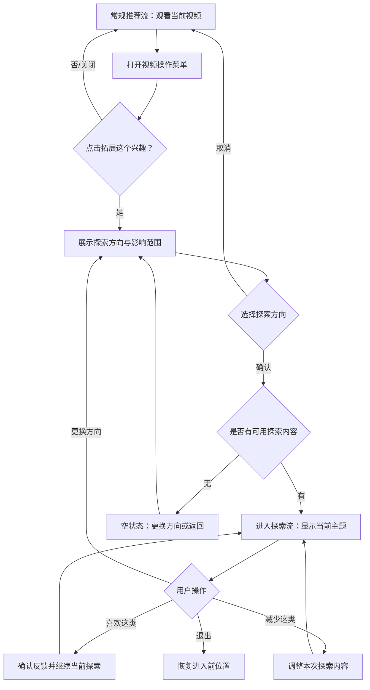

# 03｜核心流程与低保真原型说明

## 1. 主流程

## 2. 关键状态

- **常规推荐：** 默认状态，无探索标识。
- **方向选择：** 展示当前主题、方向选项、影响范围说明。
- **探索中：** 展示主题标签、反馈入口、退出入口。
- **空状态：** 解释当前方向暂时没有合适内容，允许改选或返回。
- **已退出：** 返回常规推荐并恢复原位置。

## 3. 低保真页面要点

原型文件：[`prototype/index.html`](../prototype/index.html)

### 页面 A：常规视频与入口

- 当前视频内容区域。
- 视频操作菜单按钮。
- 「拓展这个兴趣」入口。
- 测试观察：用户是否能找到入口；是否误以为是普通搜索。

### 页面 B：探索方向选择

- 当前主题，例如“城市徒步”。
- 三种方向：更多相关、相邻主题、尝试新领域。
- 影响范围说明：“仅本次探索，不更改长期推荐偏好”。
- 主按钮：「开始探索」；次按钮：「暂不探索」。
- 测试观察：用户是否理解三种方向差异；是否理解影响范围。

### 页面 C：探索内容流

- 固定状态标签“探索中”。
- 显示当前探索方向。
- 内容卡片及反馈按钮「喜欢这类」「减少这类」。
- 顶部返回或退出操作。
- 测试观察：用户是否知道自己进入了新模式；能否表达内容不合适。

### 页面 D：退出/返回

- 退出后返回原推荐流位置。
- 原型为直接退出，避免用额外确认阻碍返回；若测试发现误退问题，再评估确认弹窗。

## 4. 原型边界

- 页面与推荐内容均为示意；原型不请求网络、不连接真实算法、不存储个人偏好。
- 点击「喜欢这类」「减少这类」只展示本地状态提示，不代表系统真实学习或改变推荐。
- 原型用于可用性测试和方案讨论，不代表最终 UI 视觉稿。
